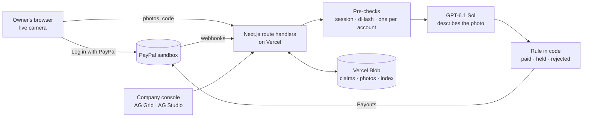

# Remedy

**Recall refunds in a minute, through PayPal, for people who really destroyed the product. Never for a faked photo.**

Live: **https://remedy-recalls.vercel.app** · Judges' demo: **https://remedy-recalls.vercel.app/r/kikea-x-vesolje/try**

Built for the PayPal AI Hackathon 2026. Everything runs on PayPal's sandbox: no real money moves.

## The problem

When a product is recalled for safety, the company often refunds owners who destroy it. Today that usually means "cut it in half and email a photo to an inbox", and someone checks each photo by hand.
- Only 6–10% of recalled products are ever returned or destroyed (PIRG, *Too Much to Recall*, 2024). The rest stay in homes.
- From 1 October to 5 November 2026, 20 of 27 refund recalls that asked for a photo had owners email it to an inbox (our count from the CPSC recalls API).
- An image model can now draw that photo. The CPSC's own request for information (CPSC-2026-0067) names "artificially generated images purporting to demonstrate product destruction".

## What Remedy does

1. **Log in with PayPal.** The owner opens the recall's claim link and logs in with PayPal. Remedy gets a verified payer ID; the owner makes no account and fills in no form.
2. **Get a one-time code.** Three characters, letter-digit-letter, with no look-alikes. The owner writes it on a tag. The camera session lasts 10 minutes.
3. **Cut it on camera.** A live camera with no upload button, on a laptop or a phone. Up to three photos: the label, the cut, the code.
4. **Paid through PayPal.** Remedy runs five checks. If all pass, PayPal Payouts sends the refund to the PayPal account that logged in, usually within a minute.

The company running the recall gets a console: every claim in an AG Grid, the evidence behind each decision, approve or reject for held claims, payouts, and a CPSC progress-report draft. Its Insights page is an AG Studio report (recall progress against the 6–10% norm, a check funnel, refusals by reason) with a Recall analyst that answers questions about the claims. The analyst reads, charts and drafts; it has no tool that can approve, reject or pay.

## What stops a fake

The model is not the defence against AI images: in our tests, no model could reliably spot one. A fake has to beat three checks that need no AI before the model even looks:

| # | Check | Uses AI? |
|---|---|---|
| 1 | Live camera session: photos must arrive inside this claim's 10-minute session | No |
| 2 | Never seen before: a perceptual fingerprint (dHash) compares every photo with every earlier claim | No |
| 3 | One claim per verified PayPal account per recall | No |
| 4 | The code, character by character: GPT-6.1 Sol reads the handwritten code and the product label, with quoted evidence | Yes, it describes |
| 5 | Really destroyed: the model describes each step of the cut, quoting what it sees | Yes, it describes |

The model only describes. A fixed rule in code, not the model, turns those answers into paid, held or rejected.

## Try it (judges)

1. Open **https://remedy-recalls.vercel.app/r/kikea-x-vesolje/try**.
2. Log in with a **PayPal sandbox personal account**. Use the test login in the Devpost testing notes, or make one at developer.paypal.com → Testing Tools → Sandbox Accounts.
3. Run the four sample claims. They use the real pipeline on sample photos:
   - **A genuine claim**: paid $29.99 in sandbox money within a minute of the photo.
   - **The wrong code**: rejected; the model reads the tag character by character.
   - **An AI image, sent in**: blocked before the model; it wasn't taken in this claim's camera session.
   - **A reposted photo**: blocked as a duplicate of an earlier claim's photo.

   Your browser's run is one demo round: its samples are checked only against each other, so judges sharing one sandbox login each see these four outcomes. **Run the samples again** on the picker starts a new round.
4. Open **https://remedy-recalls.vercel.app/signin** and log in with PayPal to see the company console with the Kikea demo recall, 40 sample claims and your own demo claims. **Insights** in the console nav opens the AG Studio report and the Recall analyst.

## PayPal and AI in the product

| Piece | How Remedy uses it |
|---|---|
| **Log in with PayPal** (OpenID Connect, `paypalattributes` scope) | Identifies owners and companies; the payer ID and verified flag gate every claim |
| **PayPal Payouts** (`/v1/payments/payouts`) | Sends each refund to the payer ID that logged in; the payout key is both `PayPal-Request-Id` and `sender_batch_id`, so a retry can never pay twice |
| **Payouts status + webhooks** (`PAYMENT.PAYOUTS-ITEM.*`, signature verified with `verify-webhook-signature`) | Keeps each claim's payout status current in the console |
| **GPT-6.1 Sol** (OpenAI Responses API, structured output) | Describes each photo against checks drafted from the recall notice, quoting its evidence |
| **AG Grid 36** | The company console's claims grid |
| **AG Studio 3** | The Insights report: custom widgets for recall progress and the check funnel |
| **Recall analyst** (a small OpenAI text model through a server proxy) | Answers questions about one recall's claims; read-only tools, company login required, rate-limited, output-capped |

## What is real and what is simulated

- **Real:** the PayPal sandbox calls (login, payouts, status, webhooks), the vision model calls, the fingerprinting and the rule. Every demo claim you run makes these calls.
- **Sandbox:** all money is PayPal sandbox money.
- **Sample photos:** the judges' demo uses prepared photos instead of your camera, and says so on every screen. Real claims use the live camera only.
- **Seeded claims:** the console starts with 40 sample claims whose verdicts are real model answers from our eval runs; they are marked as samples, use fake PayPal accounts and were never paid.
- **In this build** refunds are sent from Remedy's PayPal sandbox business account. At launch each company would connect its own.

## Evaluation

Before building, we tested the vision check on 36 claims, 3 runs per model (details in [docs/EVAL.md](docs/EVAL.md)):

| Model | Genuine claims paid | Fakes paid | Seconds a claim | Cost a claim |
|---|---|---|---|---|
| **GPT-6.1 Sol** (what we run) | 21 of 21, held out 6 of 6 | 3, all one AI image (c14) | 16 | $0.011 |
| GPT-6 Astra | 21 of 21, held out 6 of 6 | 1 (c14) | 26 | $0.064 |
| GPT-6.1 Terra | 18 of 21, held out 6 of 6 | 2 (c14) | 10 | $0.005 |
| GPT-6 Luna | 16 of 21, held out 6 of 6 | 3 (c14), 2 held out | 10 | $0.0006 |

No web photo was ever paid with the code check on.

## Architecture



One Next.js 16 app (React 19, TypeScript strict, Tailwind 4) on Vercel. No separate backend and no database: claims are JSON files in a private Vercel Blob store, written with conditional (ETag) updates.

## Run it yourself

```bash
git clone https://github.com/remedy-org/remedy && cd remedy
npm install
cp .env.example .env   # fill in as below
npm run dev            # http://127.0.0.1:3000
```

You need a PayPal developer account with a US business sandbox account (sends refunds), a US personal sandbox account (plays the owner), and a sandbox app with **Payouts** and **Log in with PayPal** turned on. In the app's Log in with PayPal settings, add the Return URL `http://127.0.0.1:3000/api/auth/paypal/callback` and tick the payer ID and verification status attributes. Full steps are in [docs/EVAL.md](docs/EVAL.md) and [docs/PRODUCT.md](docs/PRODUCT.md).

| Variable | What |
|---|---|
| `PAYPAL_CLIENT_ID`, `PAYPAL_CLIENT_SECRET` | The sandbox app's credentials |
| `PAYPAL_WEBHOOK_ID` | Optional: the webhook for `PAYMENT.PAYOUTS-ITEM.*` events at `APP_URL/api/webhooks/paypal` |
| `OPENAI_API_KEY` | For the photo check |
| `APP_URL` | Where the app runs; defaults to `http://127.0.0.1:3000` |
| `SESSION_SECRET` | Signs session cookies; required in production (`openssl rand -base64 32`) |
| `BLOB_READ_WRITE_TOKEN` | Optional: Vercel Blob; without it data lives in `data/` |
| `NEXT_PUBLIC_AG_STUDIO_LICENSE` | Optional: AG Studio licence; without it Insights shows the trial watermark |
| `ANALYST_MODEL` | Optional: the Recall analyst's model; defaults to `gpt-5.4-mini` |
| `VISION_DAILY_LIMIT`, `DRAFT_DAILY_LIMIT`, `CLAIM_DAILY_LIMIT`, `CLAIM_MONTHLY_LIMIT`, `ACCOUNT_CLAIM_DAILY_LIMIT`, `ACCOUNT_DEMO_DAILY_LIMIT` | Optional: what the live demo may spend. Per UTC day: 100 photo checks, 20 check drafts, 60 new claims (150 in any 30 days), and per PayPal account 5 real and 60 demo claims. Past the photo-check limit a real claim is held for a person, never lost ([docs/PRODUCT.md](docs/PRODUCT.md)) |

Checks: `npm run typecheck`, `npm run lint`, `npm test`, `npm run build`.

## Repository map

- `src/app`: pages and route handlers (homepage, claim flow `r/[recall]`, console, API)
- `src/lib`: PayPal client, vision check, rule, codes, fingerprinting, storage, demo data
- `src/components`: UI by surface (`home`, `claim`, `console`, `ui`)
- `eval/`: the vision-check eval and its specs
- `docs/`: product map (`PRODUCT.md`) and eval write-up (`EVAL.md`); `DESIGN.md` is the design system

## Licence

MIT
