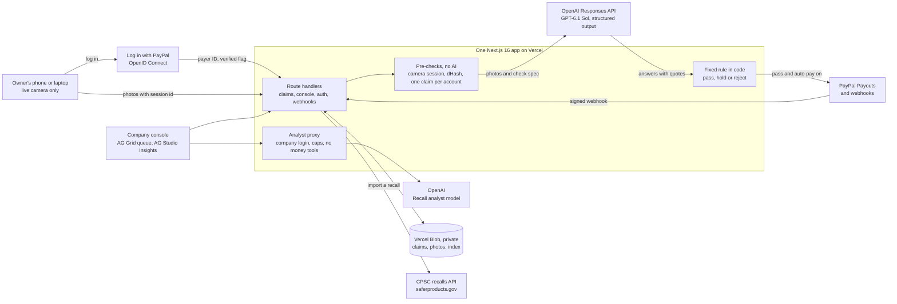
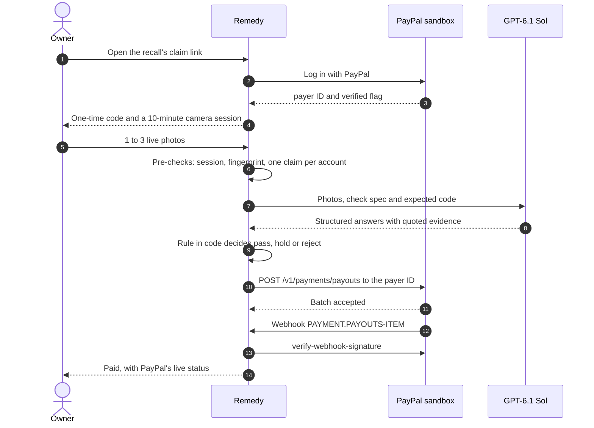

# Remedy

**Recall refunds through PayPal, for companies running CPSC refund recalls. The owner proves on a live camera that the product is destroyed; AI describes the photo, a fixed rule in code decides, and PayPal Payouts pays. Stolen and reused photos get nothing. A fake has to beat a live camera, a 10-minute code and a verified PayPal account.**

- **Live:** https://remedy-recalls.vercel.app
- **Judges' demo:** https://remedy-recalls.vercel.app/r/kikea-x-vesolje/try (a PayPal sandbox login is on the page)
- **Company console:** https://remedy-recalls.vercel.app/signin (open **Use the demo account** for the sandbox business login)

<!-- Demo video: add the YouTube link here before submitting. -->

I built Remedy solo for the PayPal AI Hackathon 2026. It runs on PayPal's sandbox, so no real money moves. MIT licensed.

**Built with:** PayPal (Log in with PayPal, Payouts, Webhooks) · OpenAI (GPT-6.1 Sol through the Responses API; gpt-5.4-mini for the Recall analyst) · AG Grid · AG Studio · Next.js · TypeScript · Vercel · the CPSC recalls API

---

## 60-second walkthrough

The demo runs on a real, public recall: **CPSC 27-071**, X-VESOLJE nursing pillows (suffocation risk, about 19,596 units, sold on Amazon by Kikea Store). Kikea Store is the firm named on that public notice, not a Remedy customer. The $29.99 refund is my demo setting; the notice says "full refund".

### Owner side (about 30 seconds)

1. Open **[/r/kikea-x-vesolje/try](https://remedy-recalls.vercel.app/r/kikea-x-vesolje/try)**. Copy the PayPal sandbox login from the **Demo account** panel and press **Log in with PayPal**.
2. Run the four claims. Each one goes through the real pipeline with a prepared photo:

   | Claim | What's in the photo | What Remedy does |
   |---|---|---|
   | **A genuine claim** | The feather-print pillow cut in half, its tag reading X-VESOLJE M4T | Passes all five checks; PayPal Payouts sends $29.99 in sandbox money to the PayPal account you logged in with |
   | **Wrong code on the tag** | A real cut pillow, but the tag reads K7Q and this claim's code is K7P | Rejected: the model reads the code character by character, and the rule in code compares it |
   | **A photo from the web** | A picture of a cut pillow never taken in this claim's camera | Blocked before any AI runs: it has no live camera session |
   | **A photo used before** | The genuine claim's photo, sent again as a new claim | Blocked before any AI runs: its fingerprint matches an earlier claim |

3. **Start over** clears the four and starts a new round. Each browser gets its own round, so judges sharing one sandbox login each see all four outcomes.

The real claim flow, with your own live camera and a fresh one-time code, is at [/r/kikea-x-vesolje](https://remedy-recalls.vercel.app/r/kikea-x-vesolje).

### Company side (about 30 seconds)

4. Press **See them as Kikea Store sees them**, or open **[/signin](https://remedy-recalls.vercel.app/signin)**. Open **Use the demo account** and log in with PayPal as the company.
5. **Claims:** the queue in AG Grid, with your four claims beside the recall's demo claims. Open any row for the evidence: the photos, every model answer with the text it quoted, the pre-checks and the rule's decision. Held claims can be approved or rejected, one at a time or in bulk.
6. **Insights:** the AG Studio report on the recall, and the **Recall analyst**. Ask it about a claim, a chart or why claims were refused.
7. **New recall:** paste any CPSC recall number or cpsc.gov link. The model drafts the photo checks from the notice for the company to edit and publish.
8. **Report:** the CPSC progress-report draft, computed from the claims and printable.

---

## The problem

When a product is recalled for safety, the company often refunds owners who destroy it. Today that usually means "cut it in half and email a photo to an inbox", and someone checks every photo by hand.

- **Recalls mostly fail.** "Only 6 to 10 percent of recalled products are returned or discarded." Fisher-Price's infant sleepers had so few returns that the recall was reannounced; linked deaths rose to about 100, at least eight of them after the original recall. Of 2023's 323 recalls, 167 offered refunds, and 87 of those had burdensome steps. ([PIRG, *Too Much to Recall*, Jan 2024](https://publicinterestnetwork.org/wp-content/uploads/2024/01/TOO-MUCH-TO-RECALL-FINAL-1-11-1.pdf))
- **The "system" is an email inbox.** I pulled every recall from 1 Oct to 5 Nov 2026 from the [CPSC recalls API](https://www.saferproducts.gov/RestWebServices/Recall?format=json&RecallDateStart=2026-10-01): 55 recalls, 36 offering refunds, 27 requiring a photo of the destroyed or marked product, and **20 telling owners to email that photo to an inbox**, some of them `@gmail.com` and `@outlook.com`. 23 of the 55 were sold on Amazon.
- **It happens every week.** Matching the same API by keyword (approximate counts), 2026 to 5 Nov has 514 recalls, 362 with a refund, 268 requiring destruction plus a photo and 238 taking that photo by email, covering 5.28M units. 157 of 2026's refund recalls send the proof to a personal webmail inbox.
- **AI broke photo proof, and the regulator says so.** CPSC's request for information CPSC-2026-0067 (15 Apr 2026) names "altered, fabricated, or artificially generated images... purporting to demonstrate product destruction", and warns that fraud controls "impose burdens on legitimate consumers and reduce recall participation" ([Federal Register](https://public-inspection.federalregister.gov/2026-07328.pdf)). The CPSC then launched a [national recall-fraud effort](https://www.cpsc.gov/Newsroom/News-Releases/2026/US-Consumer-Product-Safety-Commission-Launches-National-Recall-Fraud-Effort-as-Part-of-Trump-Administrations-Anti-Fraud-Initiative). Sedgwick, the largest recall administrator, reports 20,000 suspected fraudulent claims and "multimillion" exposure ([Foley, Jul 2026](https://www.foley.com/insights/publications/2026/07/when-recalls-go-rogue-the-impact-of-ai-fueled-recall-fraud/)).

That is the trap: photo-only refunds raise participation, and AI fakes push firms back to physical returns, which kill it. Remedy keeps the refund easy for real owners. Stolen and reused photos get nothing, and a fake has to beat a live camera, a 10-minute code and a verified PayPal account.

**Who it's for:** small and mid-size sellers running a CPSC refund recall from an inbox, often marketplace sellers. They are legally required to run the remedy, they review photos by hand, and they absorb the fraudulent refunds. Settlement tools verify the person. Remedy verifies that the product is destroyed.

---

## How it works

### The owner's claim

1. **Recall.** The owner opens the recall's claim link (from the notice's link or QR code) and sees the recall, built from CPSC data, and the refund.
2. **Log in with PayPal.** PayPal's own consent page. Remedy gets a verified payer ID. No Remedy account, no form.
3. **One-time code.** Three characters, letter-digit-letter, from an alphabet with no look-alikes (no O/0/Q, I/1/L, 8/B, 5/S, 2/Z). The owner writes it on paper, "big, about 1 inch (3 cm), in marker". For a product with no label of its own, like this pillow, they write the product name too: "Write X-VESOLJE and M4T on a piece of paper". The code is good for 10 minutes; if it runs out they get a new one.
4. **Live camera.** No upload button. One photo of the paper tag and the destroyed product is enough; up to three are allowed. On a laptop, a QR code moves the claim to a phone.
5. **Five checks**, then **Paid**, **Held** (with what a person will look at) or **Rejected** (with the exact reason). An owner can ask a person to review a rejection that turned on an uncertain read, once.

### The five checks

| # | Check | Shown in the app as | How | AI? |
|---|---|---|---|---|
| 1 | **Live camera** | Taken in Remedy's camera | Photos must carry this claim's unexpired 10-minute camera session | No |
| 2 | **Never seen before** | Photo not used before | A perceptual fingerprint (dHash, 64 bits) of every photo; a match within 8 bits of any earlier claim's photo blocks it | No |
| 3 | **One claim per verified account** | One claim per verified PayPal account | PayPal says the account is verified, and it has no other live claim on this recall | No |
| 4 | **Code and label** | Tag shows X-VESOLJE and M4T | GPT-6.1 Sol reads the label and the handwritten code, quoting what it sees; the code passes only if the text it read equals the code | Describes |
| 5 | **Really destroyed** | Pillow cut in half | The model checks each proof step from the recall notice, whether it is a photo of a screen or a print, and whether all photos show the same item | Describes |

Checks 1 to 3 run before any model call; a fail there is **blocked**. Then a fixed rule in code turns the model's answers into the decision: any "no" rejects, any "unclear" holds for a person, otherwise it passes. The model only describes. **AI never moves money.**

### PayPal: identity, money and status

| PayPal API (raw REST, `fetch`) | What Remedy does with it |
|---|---|
| **Log in with PayPal**: `GET /signin/authorize` on `www.sandbox.paypal.com` (scopes `openid profile email https://uri.paypal.com/services/paypalattributes`), `POST /v1/oauth2/token`, `GET /v1/identity/oauth2/userinfo?schema=paypalv1.1` (fallback `/v1/identity/openidconnect/userinfo`) | Identifies owners and companies. The payer ID and `verified_account` gate every claim; the session cookie is HMAC-SHA256 signed |
| **Payouts**: `POST /v1/payments/payouts` | Sends the refund with `recipient_type: PAYPAL_ID` to the exact payer ID that logged in. The claim's payout key is both `PayPal-Request-Id` and `sender_batch_id`, so a retry can never pay twice; `sender_item_id` is the claim ID |
| **Payout status**: `GET /v1/payments/payouts/{batch_id}` | The console re-asks PayPal about up to 10 unsettled payouts when it loads; the owner's receipt polls the status live |
| **Webhooks**: `PAYMENT.PAYOUTS-ITEM.*` at `/api/webhooks/paypal`, checked with `POST /v1/notifications/verify-webhook-signature` | Nothing in the body is trusted until PayPal verifies the signature on the raw bytes. Without `PAYPAL_WEBHOOK_ID` the route refuses every event |

On a pass with auto-pay on, Remedy re-reads the claim and re-runs the duplicate and account checks just before paying (a race guard), then calls Payouts. Anything that fails after the photos arrive (the model is down, the daily photo-check limit is reached, PayPal refuses, no answer within 150 seconds) **holds the claim for a person; it is never lost**. When a person approves a held claim, the same checks re-run and the same idempotent payout is used.

### The vision check

- OpenAI Responses API, `gpt-6.1-sol` at high reasoning effort, with zod structured output.
- Photos are EXIF-rotated and resized to at most 1568 px with `sharp`, then sent at original detail.
- The model gets the recall's check spec (product, what the label must show, the proof steps) and the expected code, and answers each question with quoted evidence.
- The prompt is word for word the one I evaluated (below).

### Recall setup, also AI-drafted

A company imports a recall by CPSC number or cpsc.gov link (from saferproducts.gov's REST API). The same model reads the notice's text and photos and drafts the check spec: the product, what the label must show and the proof steps. The company edits it and publishes, then sets the refund, auto-pay and the claim link with its QR code.

### The console in AG Grid

AG Grid Community 36.2 runs the claims queue, themed from the app's CSS tokens (`themeQuartz.withParams`):

- Custom cell renderers, plus tooltips for photos, checks and the claim's timeline.
- Status tabs (All, Paid, Sent, settling, Approved, Held, Rejected, Blocked, In progress) that set a custom Verdict filter, plus a custom Claim filter and quick-filter search.
- New claims stream in with `applyTransaction` from an 8-second poll; cells flash when a verdict or payout changes.
- Keyboard navigation, group-by, **Export CSV** with readable headers, and a card layout on phones.

### Insights in AG Studio

AG Studio 3.0.0 runs the Insights report:

- **Recall progress**: units remedied against units sold, next to PIRG's 6–10% typical return.
- **Decisions**, **Where claims stop** and **Why claims were refused**.
- A column chart, **Paid through PayPal, by day**.

Five custom widget types (`recall-progress`, `check-funnel`, `refusal-reasons`, `decision-mix`, `median-time`) are registered with data mappings, AI descriptions and AI format shapes, so Studio's widget agent can place them. The report also has cross-filtering, a filters panel, a theme built from the live CSS tokens, and Export CSV and Save image.

The **Recall analyst** is a custom primary agent in Studio's AI harness. It has three custom tools (`explain_claim`, `open_claim`, `draft_review_note`) and delegates to Studio's data, page and widget agents. It runs on `gpt-5.4-mini` through a server proxy, `/api/console/ai/responses`, which:

- requires a company session and keeps the OpenAI key on the server;
- drops any tool named like approve, reject, pay, refund or payout;
- caps output at 4,000 tokens, 80 requests per 10 minutes per PayPal account and 1,500 a day per server instance;
- sends `store: false`.

The analyst can read, chart and draft. It cannot approve, reject or pay.

---

## Architecture





There is no separate backend and no database. Claims are JSON in a private Vercel Blob store, written with conditional ETag (`ifMatch`) updates so two writers can't clobber each other. Without a Blob token, local dev stores everything in `data/`.

---

## Evaluation

I tested the vision check before building on it. Every number here comes from [docs/EVAL.md](docs/EVAL.md).

**Method.** I used 36 claims:

- 17 claims made of web photos: real owner photos, official examples, CPSC shots, and traps such as a screenshot or a photo of a monitor. None can carry this claim's code, so none may ever pay (one control turns the code check off).
- 14 claims made of AI images carrying a code: genuine claims, wrong codes, a photo of a screen, and one AI image with a physical flaw (`c14`).
- 5 held-out claims, written after the round-1 fixes.

Each model ran 3 times at high effort. Every answer (label, each step, code, screen) was scored against an answer key, not just the decision. The runner calls the app's own `runVisionCheck` and `decide`, so it tests exactly the prompt, schema, image resizing and rule the app runs. The table is round 2 (31 claims), 3 runs per model:

| Model | Genuine claims paid | Fakes paid | Seconds a claim | Cost a claim |
|---|---|---|---|---|
| **GPT-6.1 Sol** (in production) | 21 of 21 | 3, all `c14` | 16 | $0.011 |
| GPT-6 Astra | 21 of 21 | 1, `c14` | 26 | $0.064 |
| GPT-6.1 Terra | 18 of 21 | 2, `c14` | 10 | $0.005 |
| GPT-6 Luna | 16 of 21 | 3, `c14`, plus 2 held-out (`h03`) | 10 | $0.0006 |

GPT-6.1 Sol in full, round 2 then the 5 held-out claims: decisions right 29–30 of 31 and 5 of 5; genuine claims paid 21 of 21 and 6 of 6; fakes paid 3 (all `c14`) and 0; answers right 91% and 96%; 16 seconds a claim, 40 at most.

Across both sets, for GPT-6.1 Sol:

- **0 of 16 web photos paid**, across 48 tries.
- **9 of 9 genuine claims paid**, in all 27 tries.
- **4 of 4 wrong codes refused**, in all 12 tries.
- **1.1 cents** to check a claim.

All four models rejected every wrong code and, with the code check on, every web photo, in every run. Sol at medium effort matched high effort on the 17 web claims, at 8 seconds a claim.

**The demo recall, re-checked (9 Nov).** The demo photos are edits of the CPSC product photo, checked against the Kikea spec. Each case ran 3 times on `gpt-6.1-sol` at high effort:

| Case | Decision, 3 runs |
|---|---|
| k01 genuine, tag M4T | pass 3/3 |
| k02 tag reads K7Q, code K7P | reject 3/3, on the code alone |
| k04 not fully cut | reject 3/3 |
| k06 photo of a laptop screen | reject 3/3 |
| k10 shot far and dim | hold 3/3 |
| k03 one half in frame · k07 tag lying loose · k09 only the H showing | reject 3/3 each |
| k05 another genuine claim · k08 smudge beside the code | pass 3/3 each |

**What the eval can't show:**

- Every model, Sol included, paid `c14` at least once. `c14` is an AI image with a subtle flaw: three cut ends on two pieces. So the strict go line in the summary script still prints NO-GO. The model can't tell a clean AI image from a photo, and it is not the defence against fakes. The defence is the live camera, the code issued inside that session, and one claim per verified PayPal account.
- Every photo carrying a code is AI-made, so real handwriting in a real phone photo hasn't been tested yet.
- One person (me) wrote the answer keys and checked them by eye.
- Claude wasn't evaluated.

**Cost.** The whole spike used about $18 of OpenAI usage ($0.83 of it on images, made with `gpt-image-2.6-sunburst`). The 9 Nov demo-photo redo cost about $0.62 on images and $0.36 on vision runs.

The eval photos and raw run files (`eval/photos/`, `eval/out/`) are git-ignored, because the web photos belong to their owners. The stored model answers the app shows are committed in `src/lib/demo/verdicts.json` and `src/lib/review/replay.json`.

---

## What is real, what is sandbox, what is prepared

- **Real:** the PayPal sandbox calls (login, payouts, status, signed webhooks), the vision model calls, the fingerprinting, the pre-checks and the rule. On `/try`:
  - **A genuine claim** reaches the model and triggers a real sandbox payout.
  - **Wrong code on the tag** reaches the model and is rejected.
  - **A photo from the web** and **A photo used before** are blocked by the pre-checks before any model call.
- **Sandbox:** all money is PayPal sandbox money. This build sends every refund from Remedy's one PayPal sandbox business account. At launch, refunds go from each company's PayPal Business account straight to each owner's PayPal account, which needs PayPal partner onboarding.
- **Prepared photos on `/try`:** the four photos are AI-made edits of the CPSC product photo, each with its tag already written. Your camera isn't used there. Real claims use the live camera only.
- **The demo recall's claims in the console:** the seven claims (RM-0442, RM-9475, RM-2125, RM-0118, RM-9629, RM-6276, RM-9545) are built in memory on every request and never stored.
  - Their model answers are stored real answers from the 9 Nov runs, and the app's own rule decides them.
  - Their PayPal payer IDs are generated, and their dates move forward so the newest is always yesterday.
  - RM-0442's payout record is a stand-in, not a PayPal call. So are its timings, 15 s from photo to payout and confirmed at 55 s.
  - The claims you run on `/try` are real, and appear next to these only in your browser.

---

## Stack

- One Next.js 16.3 app with React 19.2, TypeScript (strict) and Tailwind 4, hosted on Vercel.
- AG Grid Community 36.2 and AG Studio 3.0.0.
- The `openai` SDK, zod 4 and `sharp`.
- `@vercel/blob` for storage.
- three.js, motion and lenis on the homepage; `qrcode` for claim links.
- Vitest (74 test files, about 600 cases) and Playwright scripts.

---

## Run it locally

Requires Node.js 20.9 or newer.

```bash
git clone https://github.com/remedy-org/remedy && cd remedy
npm install
cp .env.example .env    # fill in as below; .env is git-ignored
npm run dev             # open http://127.0.0.1:3000 (use 127.0.0.1, not localhost)
```

**PayPal sandbox keys** (free, at [developer.paypal.com](https://developer.paypal.com)):

1. **Testing Tools → Sandbox Accounts:** create a **US business** account (it sends refunds) and a **US personal** account (it plays the owner). Don't use India sandbox accounts: Payouts fails with `USER_COUNTRY_NOT_ALLOWED`.
2. **Apps & Credentials → Sandbox → Create App:** choose Merchant and the US business account. Copy the Client ID and Secret into `PAYPAL_CLIENT_ID` and `PAYPAL_CLIENT_SECRET`.
3. On the app's page, tick **Payouts** and **Log in with PayPal**:
   - Set the Return URL to `http://127.0.0.1:3000/api/auth/paypal/callback` (that is `APP_URL` plus `/api/auth/paypal/callback`). A `localhost` Return URL fails to save with HTTP 520.
   - Under **Advanced settings**, tick email, full name, **PayPal account ID (payer ID)** and **account verification status**.
4. Optional: add a webhook on the app at `APP_URL/api/webhooks/paypal` for the `PAYMENT.PAYOUTS-ITEM.*` events. It needs a public URL. Put its ID in `PAYPAL_WEBHOOK_ID`.
5. Log in to Remedy with a sandbox account that doesn't own the app. The owning business account gets a bare 401 from userinfo ([FEEDBACK.md](FEEDBACK.md)).

**OpenAI key:** create one at [platform.openai.com](https://platform.openai.com/api-keys) and put it in `OPENAI_API_KEY`. The account needs access to the vision model (`gpt-6.1-sol` by default, or set `VISION_MODEL`).

| Variable | What it does |
|---|---|
| `PAYPAL_CLIENT_ID`, `PAYPAL_CLIENT_SECRET` | The sandbox app's credentials (required) |
| `PAYPAL_API_BASE` | Defaults to `https://api-m.sandbox.paypal.com`. The `/try` demo only runs while this is the sandbox |
| `PAYPAL_WEBHOOK_ID` | Optional. The webhook to verify events against; unset, the webhook route refuses every event |
| `OPENAI_API_KEY` | Photo checks, recall-check drafts and the Recall analyst (required) |
| `VISION_MODEL`, `VISION_EFFORT` | Optional. Default `gpt-6.1-sol` and `high` (`low`, `medium`, `high`, `xhigh`) |
| `ANALYST_MODEL` | Optional. The Recall analyst's model; default `gpt-5.4-mini` |
| `APP_URL` | Public base URL, for login returns, webhooks and claim links. Default `http://127.0.0.1:3000` |
| `SESSION_SECRET` | Signs session cookies, at least 32 characters (`openssl rand -base64 32`). Optional locally, required in production |
| `BLOB_READ_WRITE_TOKEN` | Optional. A Vercel Blob store; without it data lives in `data/` |
| `NEXT_PUBLIC_AG_STUDIO_LICENSE` | Optional. Without it Insights shows AG Studio's trial watermark |
| `SANDBOX_PERSONAL_EMAIL`, `SANDBOX_PERSONAL_PASSWORD` | Optional. In a sandbox build, shown on `/try` as the demo login |
| `SANDBOX_BUSINESS_EMAIL`, `SANDBOX_BUSINESS_PASSWORD` | Optional. In a sandbox build, shown on `/signin` under **Use the demo account** |
| `VISION_DAILY_LIMIT`, `DRAFT_DAILY_LIMIT` | Optional. Per UTC day: 100 photo checks and 20 check drafts. Past the photo-check limit, a real claim is held for a person, never lost |
| `CLAIM_DAILY_LIMIT`, `CLAIM_MONTHLY_LIMIT` | Optional. 60 new real claims a day and 150 in any 30 days. Demo claims don't count |
| `ACCOUNT_CLAIM_DAILY_LIMIT`, `ACCOUNT_DEMO_DAILY_LIMIT` | Optional. Per PayPal account a day: 5 real claims and 60 demo claims |

`.env.example` also lists `PAYPAL_RECEIVER_EMAIL`, `PAYPAL_REDIRECT_URI` and `ANTHROPIC_API_KEY`. They are left from the spike, and the app doesn't read them.

**Checks:** `npm run typecheck`, `npm run lint`, `npm test`, `npm run build`. The vision eval is `npm run eval:run`, then `npm run eval:summarize`. It needs your own photos in `eval/photos/` (see [docs/EVAL.md](docs/EVAL.md) for the case format).

---

## Project layout

```
src/app/                 pages and route handlers
  (marketing)/           homepage
  r/[recall]/            owner claim flow; /try is the judges' demo
  console/               claims, insights, recalls/new, recalls/[id], report
  signin/, privacy/, terms/
  api/                   auth/paypal, claims, console (incl. ai/responses proxy), webhooks/paypal
src/lib/                 the logic, unit-tested
  paypal/                REST client, Log in with PayPal, Payouts, status, webhook verification
  vision/check.ts        the photo check (prompt, schema, image prep)
  rule.ts                pre-checks and the decision rule
  fiveChecks.ts          the five checks' names
  codes.ts, ids.ts       one-time codes, claim IDs, payout keys
  fingerprint.ts         dHash duplicate detection
  spec.ts, cpsc.ts       recall import and check drafting
  store/                 Vercel Blob and local stores
  demo/                  the demo recall, its claims and the /try samples
src/components/          UI by surface: home, claim, console, insights, legal, ui
eval/                    the vision eval: runner, summary, specs, photo maker
scripts/                 screenshots, e2e, dev sessions, demo assets
docs/                    PRODUCT.md (product map), EVAL.md (eval write-up)
DESIGN.md                the design system
FEEDBACK.md              issues I hit in PayPal's developer tools
```

---

## Limits

- **Sandbox only.** No real money moves, and every refund comes from Remedy's one sandbox business account until per-company payouts land through PayPal partner onboarding.
- **The model is not the fake detector.** It can't tell a clean AI image from a photo (see `c14`). The live camera, the in-session code and one claim per verified account are what make faking expensive.
- **Not yet tested on real handwriting** in a real phone photo. Every code-on eval photo is AI-made.
- **US recalls.** The importer reads CPSC data, and the sandbox setup uses US accounts.
- **Pilot-sized storage.** JSON files in Vercel Blob, no database. The claim caps (above) size real claims to Blob's Hobby plan, and anything that hits a cap says when it reopens.
- **UNCLAIMED payouts** are shown in the console but not reissued automatically.

## Feedback to PayPal

[FEEDBACK.md](FEEDBACK.md) logs what I hit in PayPal's developer tools while building this, including a `localhost` Return URL that fails to save with HTTP 520, a bare 401 from userinfo for the app-owner account, `verified_account` arriving as the string `"true"`, and India sandbox accounts refused by Payouts.

## Licence

[MIT](LICENSE) © 2026 mohit-1710
